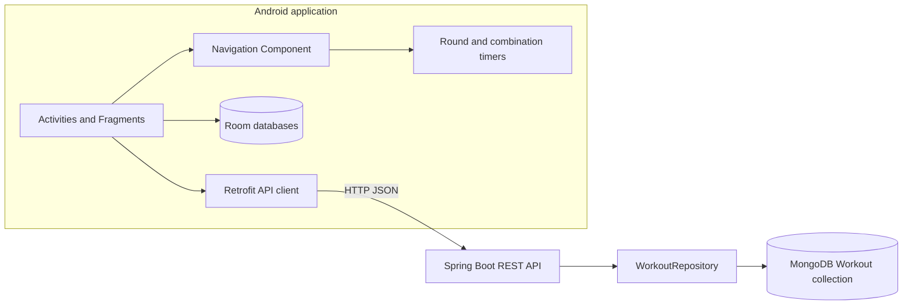
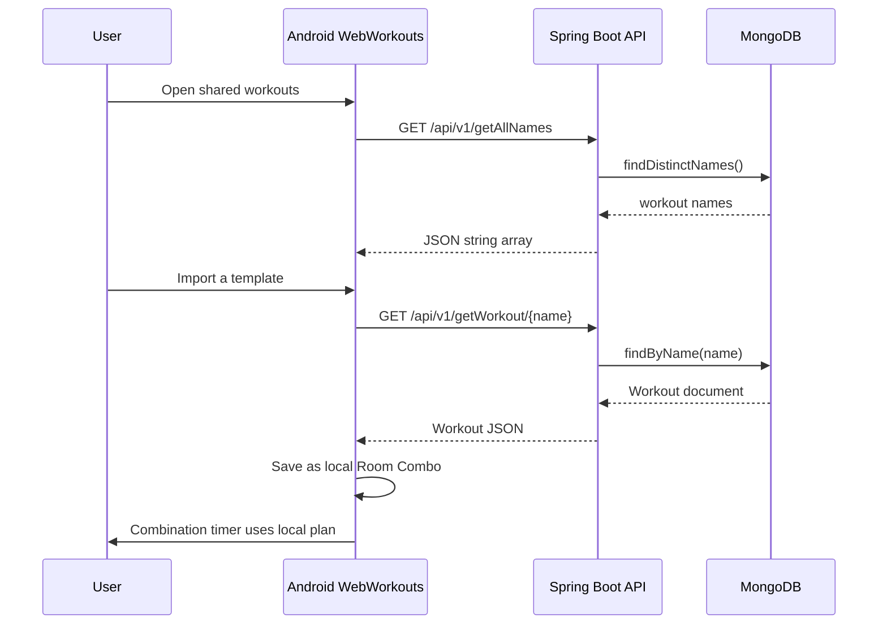

# Boxing Assistant

Boxing Assistant is a Java Android application for setting up boxing rounds and timed combinations. Users can create local timer presets, build exercise sequences, run round/rest/preparation timers with audible cues, and keep a local music list. The app can also browse shared workout templates from a small Spring Boot and MongoDB API.

## Verified features

- Standard round timer with configurable round count, round duration, rest duration, preparation period, pause/reset controls, and sound cues.
- Combination timer that displays moves and advances through their configured durations during a round.
- Local Room storage for timer presets, combination workouts, and music selections.
- Create, edit, rename, delete, and select local workout plans; import shared plans and share local plans through the REST API.
- Music selection through Android's system document picker and in-app playback controls.
- Tutorial screens and Android Navigation Component screen flows.

The local workout and timer flows are available offline. The remote API is used for shared workout names and templates; it is not a server-backed timer or account system.

## Technology and architecture

- Android client: Java 8 source compatibility, Android Gradle Plugin 4.1.3, Gradle 6.5, compile/target SDK 30, minimum SDK 23; Gradle requires JDK 8–14.
- AndroidX Navigation 2.3.5, Room 2.4.0-alpha04, Retrofit 2.1.0, OkHttp 3.4.1, Gson 2.6.2, Material Components 1.4.0.
- Backend: Java 17, Spring Boot 3.0.2, Spring Web, Spring Data MongoDB, Bean Validation, Maven, MongoDB.

The Android app owns interactive timers and local data. The backend stores named shared workout templates. More detail: [Architecture](docs/ARCHITECTURE.md), [Development](docs/DEVELOPMENT.md), [API](docs/API.md), [Security](docs/SECURITY.md), and [Interview guide](docs/INTERVIEW_GUIDE.md).

## Verified API interaction

The client fetches the shared template names, requests a selected template, converts its moves and timing configuration into a local Room `Combo`, and then runs the local combination timer:

## Quick start

Prerequisites and exact commands are in [docs/DEVELOPMENT.md](docs/DEVELOPMENT.md). The backend uses Java 17 and Maven; its Mongo URI is set with `MONGODB_URI`. Docker Compose provides a local-only MongoDB and backend setup. The Android project keeps its original Gradle 6.5 / AGP 4.1.3 toolchain and therefore requires a compatible JDK and Android SDK installation; see the toolchain note before building.

For the Android emulator, the default debug API URL is `http://10.0.2.2:9093/`, which forwards to the host machine's port 9093. For a physical device on a trusted local network, set `BOXING_API_BASE_URL` to the host's reachable LAN address in a local Gradle property; do not commit a machine-specific address. Cleartext HTTP is allowed only by the debug manifest.

## Current limitations

- The Android build uses an old toolchain and several old dependencies. No broad upgrade is included pending a reproducible baseline build.
- Existing Android unit tests are starter examples; emulator tests have not been demonstrated in this environment.
- Shared workout API calls do not provide authentication, authorization, rate limiting, or ownership.
- The backend stores workout templates, but the Android timers and user-created plans remain local.
- No production deployment or production database configuration is included.
- Timer execution uses Android `CountDownTimer`; background timing accuracy and state restoration have not been proven across process death or device sleep.

## Security and privacy

Only Internet access is declared in the Android manifest. Music is selected with the system document picker; the app does not request broad storage, camera, or microphone access. Android debug builds permit local HTTP for emulator development; release builds do not inherit that allowance. The API client does not log request or response bodies. Local Compose credentials are disposable development defaults and must never be reused outside the local environment. See [Security](docs/SECURITY.md).

No screenshots are included because the tracked tutorial images are instructional assets rather than verified captures of the current running application.
